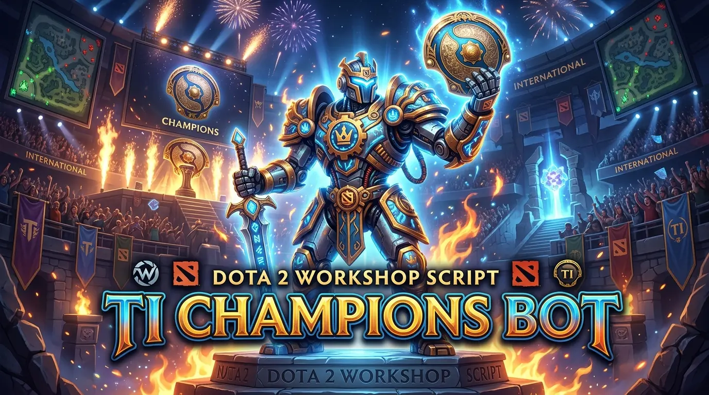

<p align="center">
  
</p>

<h1 align="center">TI Champions Bot</h1>

<p align="center">
  A heavily customized Dota 2 bot script — Lua, built on Valve's in-game bot
  scripting API — tuned for offline/local custom lobbies against the built-in
  AI, with position-aware drafting, lane discipline, objective timing, and a
  bot roster drawn from The International 2026 team rosters.
</p>

<p align="center">
  <a href="#features">Features</a> ·
  <a href="#how-to-use">How to Use</a> ·
  <a href="#project-status--ongoing-work">Project Status</a> ·
  <a href="#known-issues--limitations">Known Issues</a> ·
  <a href="#credits">Credits</a>
</p>

---

## What this is

This is a from-scratch rewrite and extension of the [Open Hyper AI](https://github.com/forest0xia/dota2bot-OpenHyperAI)
Dota 2 bot script, built iteratively by playing real local-lobby matches
against the bots, logging what went wrong, and root-causing it against the
actual match console log and source — not guessing at fixes. [`CHANGELOG.md`](CHANGELOG.md)
is a running record of ~20 versions of that process: compile crashes, lane
and position mis-assignment bugs, objective-timing gates, drafting fairness,
and combat decision tuning.

It's part of my personal project portfolio — see
[cz-portfolio-site](https://github.com/ChimCatz/cz-portfolio-site) for the
rest of my work.

## Features

- **Position-aware drafting** — a weighted-random pick system
  (`hero_selection.lua` + `FuncLib/data/hero_pos_weights.lua`) scores all 127
  current Dota heroes per lane position (1–5), factors in counter/synergy
  matchup data, and picks from a weighted top-5 shortlist rather than a fixed
  list. Supports Captain's Mode, Random Draft, and 1v1 Mid, plus live
  `!pick`/`!ban` chat commands.
- **Configurable hero pool** (`Customize/general.lua`) — ban specific heroes,
  force specific picks per side/position, cap how many "weak" (under-tuned)
  heroes a team can draft, and tune the penalty curve. Documented inline with
  the current weak/buggy hero lists and the reasoning behind each.
- **Lane discipline & objective timing** — cores are locked to their assigned
  lane through the laning phase with hysteresis (no mode-thrashing), Roshan
  is hard-gated behind a 30-minute timer with a numbers-advantage check, and
  a dedicated decision-policy layer arbitrates between farming, defending,
  pushing, and fighting.
- **Per-hero combat logic** — ~130 individual `BotsLib/hero_*.lua` behavior
  files (skill builds, item builds, ability sequencing/combos) on top of a
  shared `FuncLib/` library of ~300 utility functions (targeting, positioning,
  combat forecasting, item/ability usage, map awareness).
- **Dynamic comeback economy** — a flat, capped, per-hero gold/XP catch-up
  grant for bots that fall behind in net worth, running in the actual
  game-rules VScript context (the only place the engine exposes
  `PlayerResource`). See
  [`3246316298/Buff/DynamicComeback_README.md`](3246316298/Buff/DynamicComeback_README.md).
  Inspired by FretBots' approach to the same `PlayerResource`-reachability
  problem.
- **TI 2026 bot identities** — bots are named after real The International
  2026 pro players, matched to their actual roster position
  (`reference-data/TI_2026_All_16_Teams_Players.csv` was the source for this;
  see `Customize.Random_TI_Rosters` / `Customize.Fixed_Position_Names`).
- **Localization** — chat/diagnostic strings in English, Chinese, Russian,
  and Japanese (`FuncLib/systems/localization.lua`).
- **Self-validating diagnostics** — rate-limited, tagged log lines
  (`[TICB-HEARTBEAT]`, `[TICB-VALIDATE]`, `[TICB-RUNE]`, etc.) so a future
  regression surfaces in the console log immediately instead of requiring
  another multi-match investigation.
- **Static test harness** (`tests/validate_ticb.lua`) — stubs the Dota engine
  globals so the Lua source can be parsed and basic invariants checked
  outside the actual game client.

## Project status / ongoing work

This is an actively-iterated personal project, not a finished product — I
play a match, read the log, fix what's broken, and commit. Recent/current
focus (see the latest entry in [`CHANGELOG.md`](CHANGELOG.md)):

- Widening hero-pick variety without breaking positional role-fit.
- Making ultimates fire for clear single-target kills, not just scripted
  team-fight states (Sand King, Treant Protector).
- Reducing bot passivity — bots should trade in a fair fight instead of
  standing still and absorbing hits down to a retreat threshold.
- A support-ward routing bug that pulled bots out of lane mid-laning-phase.

## How to use

This repo **is not a standalone Workshop item** — it's a full source override
on top of the upstream [Open Hyper AI](https://steamcommunity.com/sharedfiles/filedetails/?id=3246316298)
Workshop script. To run it yourself:

1. In Dota 2, subscribe to **Open Hyper AI** in the Steam Workshop and let it
   download.
2. Replace the downloaded script folder's contents with this repo's
   [`3246316298/`](3246316298/) folder — either by symlinking it into
   `.../dota 2 beta/game/dota/scripts/vscripts/bots` (see
   [`3246316298/Install-to-vscript/README.md`](3246316298/Install-to-vscript/README.md)
   for platform-specific quick-install scripts), or by copying it in
   directly.
3. Create a **Custom Lobby** with **Local Host** as the server, enable
   cheats, fill empty slots with bots, and start the game.
4. *(Optional)* To enable the dynamic comeback economy system for that match,
   open console after the map loads and run `sv_cheats 1` then
   `script_reload_code bots/Buff/DynamicComeback` — see
   [`3246316298/Buff/DynamicComeback_README.md`](3246316298/Buff/DynamicComeback_README.md)
   for why this can't just run automatically.
5. To tweak behavior without touching the source, edit
   [`3246316298/Customize/general.lua`](3246316298/Customize/general.lua)
   (hero bans/picks, weak-hero handling, localization, trash talk, etc.) —
   it's designed to be the single file you need to touch for day-to-day
   tuning.

To validate the Lua source without launching the game:

```bash
lua tests/validate_ticb.lua
```

## Repository structure

```
3246316298/              The bot script itself (deployed as the vscripts/bots folder)
├── BotsLib/              ~130 per-hero behavior files (skills, items, combos)
├── FuncLib/               Shared utility library — see FuncLib/README.md
│   ├── data/               Static data: hero weights, matchups, item/hero names
│   ├── systems/            Decision policy, combat safety, lane tactics, ward/item/skill systems
│   └── hero/               Captain's Mode logic, minion/summon control, Rubick spell-steal per hero
├── Buff/                  Dynamic comeback economy (runs outside the bot-AI sandbox)
├── Customize/             general.lua — user-facing config, read this first
├── FretBots/              Matchup/counter data
├── Install-to-vscript/    Quick-install symlink scripts (Win/macOS/Linux)
├── mode_*.lua             Top-level bot modes (laning, farm, retreat, roshan, ward, push, ...)
├── hero_selection.lua     Draft/pick engine
└── item_purchase_generic.lua / ability_item_usage_generic.lua   Shared buy/cast logic

reference-data/           Source reference material used while authoring buy lists & bot identities
tests/                    Static Lua validation harness (no live game needed)
docs/                     README assets
CHANGELOG.md              Full version history
```

## Known issues / limitations

Some of these took multiple fix passes and may still resurface — flagging
them honestly rather than implying they're solved for good:

- **`PlayerResource` is unreachable from the normal bot-AI script context** —
  confirmed in a live match, and independently confirmed by the original
  FretBots author hitting the same wall. This is why the comeback economy
  system has to run as a separate VScript (`Buff/DynamicComeback.lua`) with
  manual per-match activation instead of just working automatically.
- **Lane/position assignment has been a recurring bug class** — at least
  three distinct root causes have produced a hero being drafted for one
  position but treated as another, or laning in the wrong lane entirely
  (`0.7.0`, `0.7.4`, and the `0.6.7`/`0.6.9` laning-phase-flag bugs). A
  self-validating diagnostic (`[TICB-VALIDATE]`) now logs a warning the
  moment this happens again, but the underlying engine behavior (two
  `GetTeamPlayers()` calls that can disagree on order) is still a sharp edge
  any future change in this area needs to respect.
- **Bot passivity / aggression tuning is an ongoing balance act** — several
  passes have loosened retreat thresholds and combat-commit kill-ratio
  requirements (most recently: an even 1v1 trade now clears the bar to fight
  back, where it previously required a favorable one). This is inherently a
  "feel" tradeoff between bots that disengage too early and bots that
  overextend into bad fights, so expect further tuning.
- **A handful of heroes are banned outright**, not just deprioritized:
  Muerta, Marci, Lone Druid, Primal Beast, Dark Willow, Elder Titan,
  Hoodwink, Wisp, and Kez — these have confirmed engine-side (Valve) bugs
  affecting bot behavior, not just under-tuned bot logic. See the Appendix in
  `Customize/general.lua` for the full weak/buggy hero breakdown and the
  reasoning per hero.
- **Objective and ward logic has needed several independent fixes** for bots
  walking into each other at Roshan, wards going up in useless spots, and
  (most recently) support bots getting pulled out of an active lane to go
  ward mid-laning-phase. The pattern so far is "fixed for the specific
  scenario found in that match's log," not an exhaustive fix — new
  scenarios keep surfacing from new matches.
- **No automated in-game test suite** — `tests/validate_ticb.lua` catches
  parse errors and a handful of static invariants, but behavioral
  correctness is still verified by playing matches and reading the console
  log by hand. This is the main limitation of the whole project's workflow.

## Credits

- **[Open Hyper AI](https://github.com/forest0xia/dota2bot-OpenHyperAI)** by
  forest0xia — the upstream Dota 2 Workshop bot script this project is built
  on top of. Architecture, the base `FuncLib`/`BotsLib` structure, and the
  original hero behavior files all trace back to this project.
- **FretBots** — referenced for the `PlayerResource`-unreachable-from-bot-AI
  problem and the run-outside-the-sandbox pattern used by
  `Buff/DynamicComeback.lua` (`Buff/README.md` documents the original
  inspiration for that subsystem).
- **[Valve's Dota 2 Workshop bot scripting documentation](https://developer.valvesoftware.com/wiki/Dota_Bot_Scripting)**
  for the underlying bot API this entire project is written against.
- Development iteration assisted by **Claude Code** (Anthropic) — see commit
  co-authorship in `git log` and [`CHANGELOG.md`](CHANGELOG.md).

---

<p align="center">
  Built by <a href="https://github.com/ChimCatz">ChimCatz</a> ·
  part of the <a href="https://github.com/ChimCatz/cz-portfolio-site">project portfolio</a>
</p>
